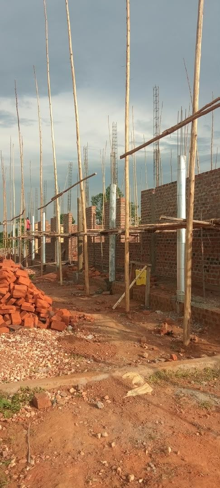
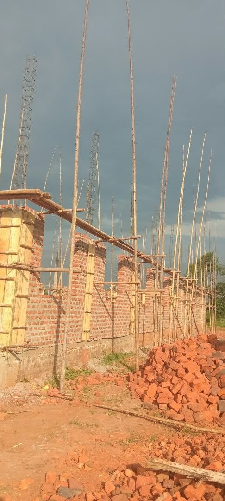
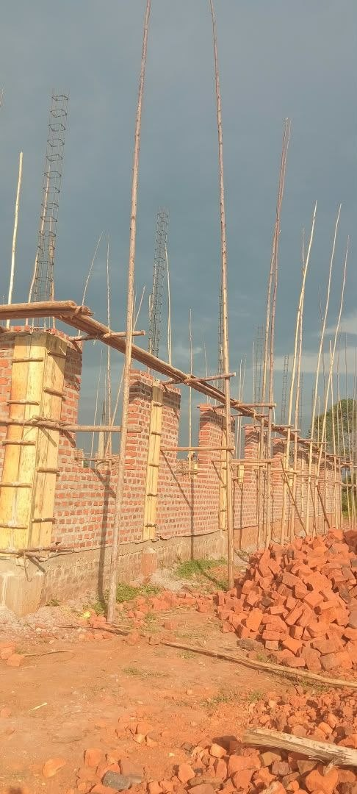
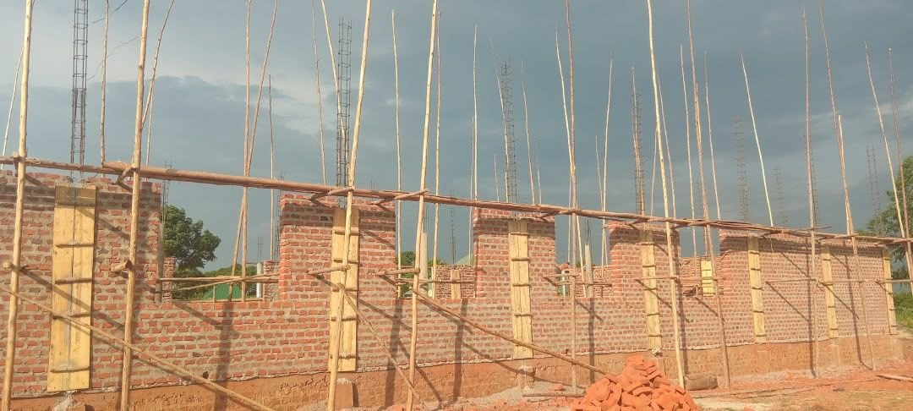

Dear intercessors, here is a short update on the work in Uganda after a conversation with Bonney this evening.

Since our visit, the outpouring of God’s Spirit has swept through the region like a ‘burning bush’ (Bonney’s own words).

The testimonies keep spreading to entirely new areas where even other dialects are spoken, but God’s Spirit reveals Jesus and His salvation.

In the seven churches, believers are baptized constantly (daily), and the importance of this has been embraced.
Every day people continue to come to Jesus and turn their backs on the world of idolatry.

The 70 full-time workers move like an army together with the believers from the seven churches. They travel everywhere, just like the disciples, and see the Kingdom breaking through as they bring in the harvest of souls.

Construction of the large multipurpose hall of 40 x 15 metres is in full swing.
This place (Jerusalem) will become the centre of the revival.
The hall will be used for the Bible schools, to constantly train new disciples and leaders. It will also be used for Sunday gatherings, conferences and, once we are ready, as an educational venue with a large screen so that we can give seminars from the Netherlands on a wide variety of topics.

It will also make it possible, for example, to show the film about Jesus in the middle of the bush!

In short, a spiritual hotspot where tens of thousands can be trained and equipped via a Starlink satellite connection.

Keep praying, and please also donate to the building project. According to Scripture, every gift to the poor is a ‘loan to the Lord’.
How special is that, and what a privilege to be able to give.

Two more instalments of 30,000 are still needed!

You can transfer your gift to the ANBI foundation
Bread for the hungry ministries
NL11RABO 0317 2284 63

Receive our warm blessings,
Bert and Nancy

<video controls preload="metadata" playsinline src="/media/video/issue-10-video-1.mp4#t=0.1"></video>

<video controls preload="metadata" playsinline src="/media/video/issue-10-video-2.mp4#t=0.1"></video>

