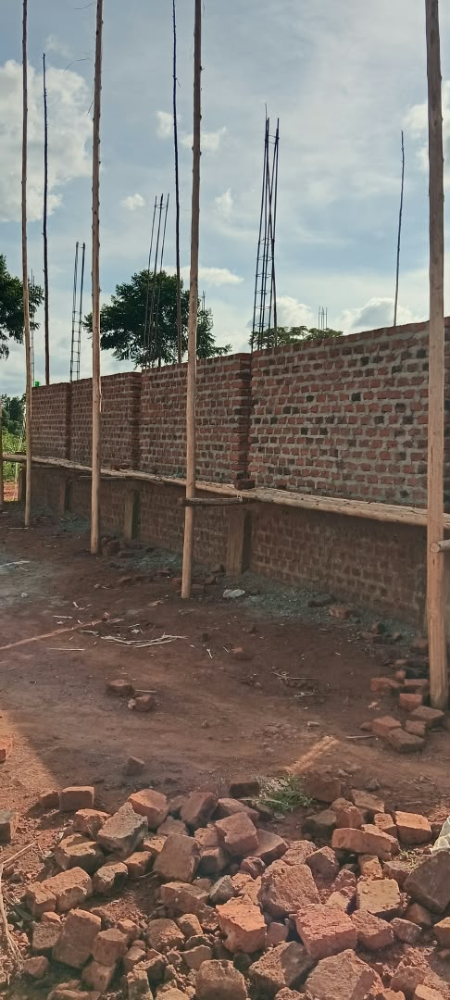
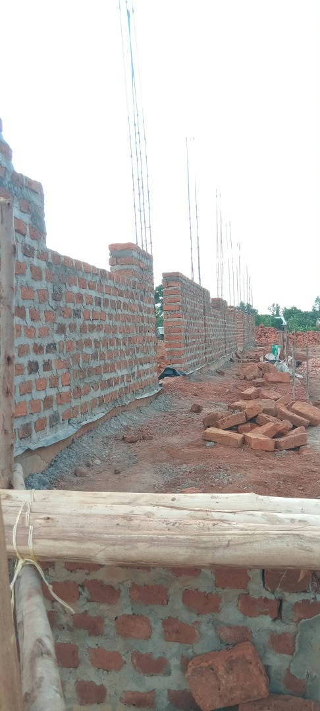
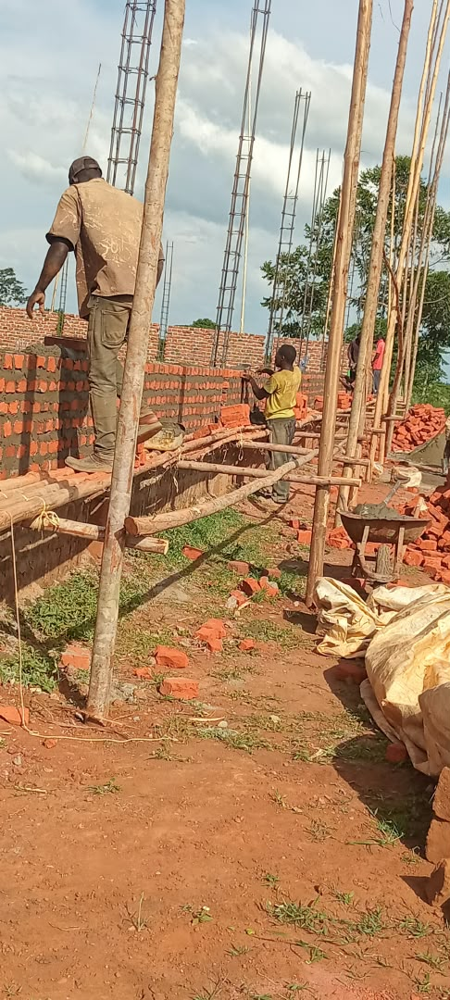
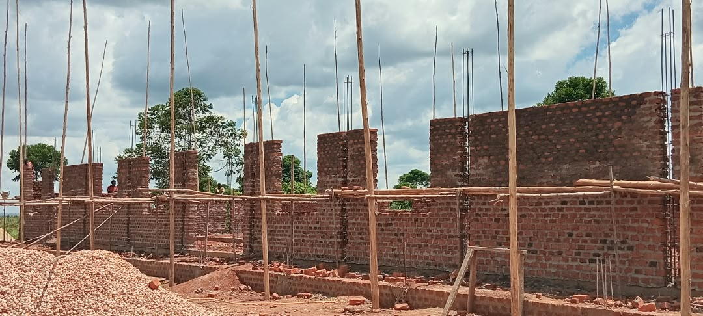
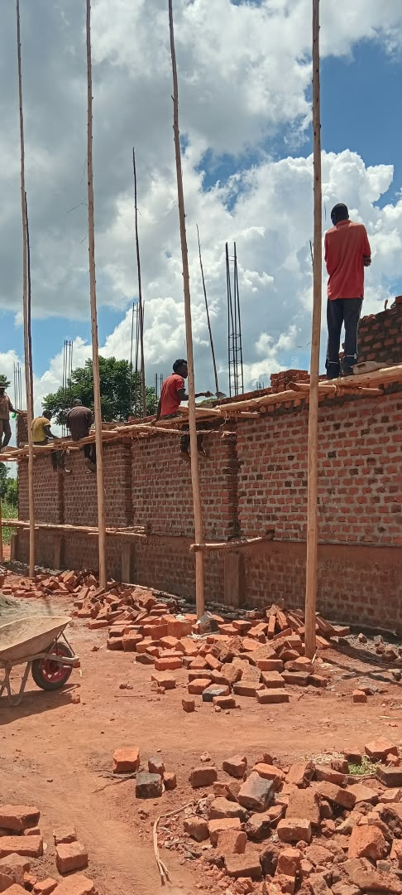

After an overwhelming mission trip, we are glad to report that construction of the foundation for the new multifunctional building is in full swing. Everything is done by hand: without a cement mixer, wheelbarrow or water hose, the building is going up stone by stone.

Three further phases are planned, each costing €30,000: walls, doors and windows (including a toilet block and sleeping quarters for Bible school students), then the roofs, and finally the finishing work and completion.

The building will be a place for seminars, training and pastor conferences. Our desire is to equip thousands of believers here via a satellite link. In an area that lived under witchcraft for centuries, the gospel is now spreading rapidly. The door is open, it is harvest time!

Will you help build?

Would you like to pray or contribute to the next building phase? Every gift helps to complete this building, stone by stone.
