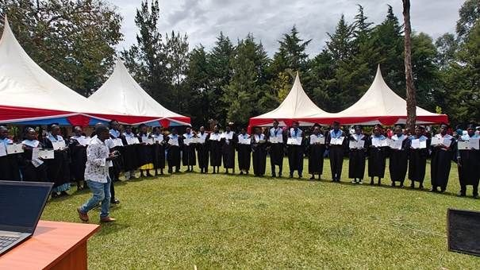

On Thursday 12 November, more than 40 full-time Bible school students at our Bible School in Webuye - Kenya received their much-desired diploma. Because we ourselves are travelling to Northern Kenya at the end of November for the Bible school that started there in January, brother Dick Pieterman represented us in Webuye.

The impact of this Bible school is enormous, and in its 16 years of existence it has already brought forth more than 100 churches.

Below is the address to the students by David Waluku, the director of the Bible School:

Praise the Lord!

Today I stand before you not only as your director, but also as a co-founder together with Pastor Bert de Haan and Pastor Dick Pieterman, who saw this school in a vision before it had a building, before it had students, before it had anything - only a promise from God.
When we started the Bible School, we had no money. We only had faith. Today I look at you in your gowns and I say: God is faithful!

To our sponsors: You are the pillars. You gave your money, your most faithful prayers. You believed in a vision that you could not yet see.
Hebrews 6:10 says: ‘God is not unjust; he will not forget your work.’ God will not forget you. On behalf of the Bible School I say – ‘Asante sana’. May your barns never run dry.

To our leadership team and our teachers: You carried this vision with us. When I was tired, you prayed. When students were weak, you strengthened them.
As John Maxwell said: ‘A leader is one who knows the way, goes the way, and shows the way.’ You have shown the way.
You did not only teach the Bible, you lived the Bible before these students.

To our graduates - my ‘children’: You are my first fruits. You are the reason the Bible School was founded.
We did not build this school for competition. We built it on unity and trust. Ecclesiastes 4:12 ‘A cord of three strands is not quickly broken.’ Sponsors, teachers and students - we became one cord, and that is why we stand here today.
As the African proverb says: ‘If you want to go fast, go alone. If you want to go far, go together.’ We chose to go together, and we have come far.

What now?

Graduating is not a farewell. It is a sending out.
2 Timothy 2:2 says: ‘And the things you have heard me say... entrust to reliable people who will also be qualified to teach others.’ I now entrust the gospel to you.
Go! Go and plant churches. Go and preach with love. Go and serve with humility.
As Nelson Mandela said: ‘It always seems impossible until it is done.’ We have been allowed to do it. And you will do greater things.
Jeremiah 29:11 ‘For I know the plans I have for you, declares the Lord, plans for peace and not for evil, to give you a hopeful future’

The Bible School will continue. We will train more students. We will send out more disciples. Because the harvest is still great.

I bless you today. Go with success. Go in power. Go in the name of Jesus.

I am proud of you
God bless the Bible School!

