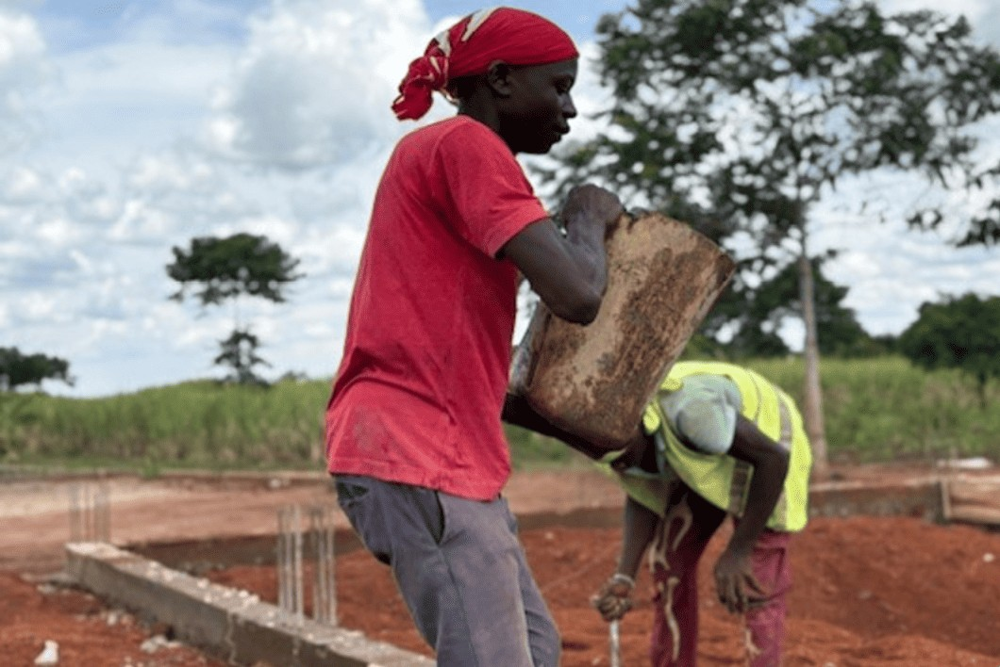
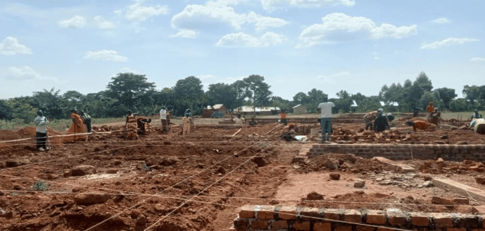
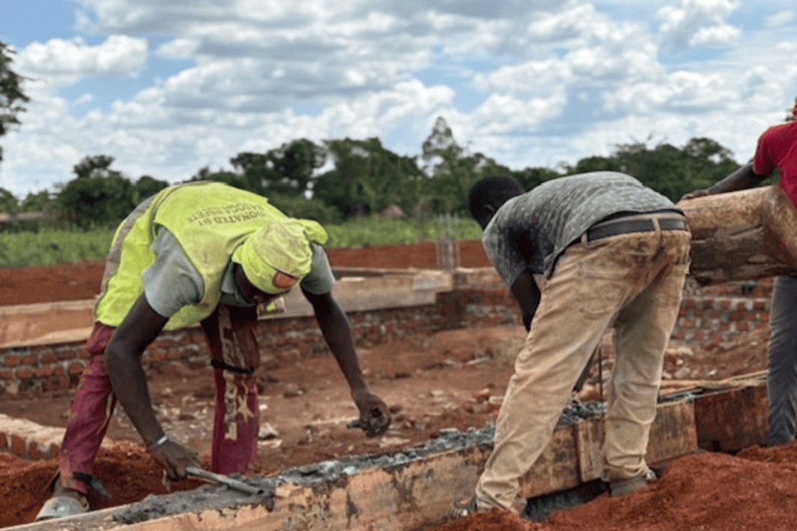

## Mission trip to eastern Uganda

The mission trip to Uganda was overwhelming and the impact enormous. In a short time we were able to do a great deal by God’s grace. The ministry team of 70 workers is growing and becoming more and more mature in its range of tasks. Bonney now lives in the revival area, and three spiritual sons will also be housed with him. In this way he can delegate more and more and devote himself to leading this mega project, supported by Henry and Emma (the pastors of ‘Jerusalem’ and ‘Samaria’).

The construction of the foundation is in full swing, and realising that all of this is ‘manual labour’ takes us almost back to the Stone Age. There is no cement mixer, no wheelbarrow and no hose bringing in water.

We discussed the further building plans extensively, and there are three planned follow-up phases of € 30,000 each:

- The first phase involves building the walls and fitting doors and windows, including the toilet block and sleeping quarters for the Bible school students;
- The second phase involves building the roof structure and placing the roofs with drainage;
- The third phase involves the finishing (plastering, painting and electrics) as well as the completion (paving around the building).

The multifunctional building will also be used for seminars on marriage, family, sexuality and children, as well as for training in, among other things: deliverance, healing, discipleship and evangelism. It also offers immense possibilities for ‘pastor conferences’. We experience that we are increasingly receiving a divine mandate in eastern Uganda, and we want to make the most of it while we can.

Our vision is that a large screen will be placed in the new building and that we will be able to train thousands of believers from here via a satellite connection. Showing films such as the film about Jesus will also shake the area to its foundations. Do not forget that the area has lived under witchcraft for many hundreds of years and that the light of the gospel is now spreading at lightning speed. The door is open; it is now the (harvest) time.

## We are looking for sponsors

We realise that putting up such a multifunctional building is a step of faith. However, we have learned from God’s Word to start moving when God plants His vision in our hearts. So far the Lord has provided mightily: the land is owned, the foundation is almost laid and paid for, and: ‘the people have a mind to work’.

We ask for your financial support and prayer involvement, and perhaps to be a channel to sponsors and companies. A sponsor letter is available, which can be sent to you on request so that you can make the connection yourself within your sphere of influence.

I want to pray out the powerful word from the book of Nehemiah as a confession over this project: ‘The God of heaven will make us prosper, and we His servants will arise and build’ (Neh. 2:20)

In faith we have taken the first step, and that consists of laying the foundation.

Keep praying and giving for our daughter churches and this mega project.
