It was an overwhelming day with great joy, many tears, deep worship and wonderful breakthroughs.

It was a day full of highlights! The children’s ministry has been “launched” with beautiful materials and methods, especially for the young children. Janine and Arnold did great preparatory work. 70 children’s workers have been instructed and now have the same materials, so that in all 7 churches the children receive the same lessons

Secondly, a government official attended the service. Vincent spoke about the Father heart of God, and the man was so touched by the message about the important role of the man in the family that he came forward for prayer and later said: all Ugandan men need to know this. We need this. Please pray that he will spread the message further in his circles of influence. This is truly a big problem in Uganda, which leaves families and communities completely disrupted

Pastors from other churches were also present. Bert spoke about the mystery of the church and explained, among other things, that the Church of Jesus Christ is one universal church and not a collection of separate little kingdoms. This was completely new to them. In tears they repented because they realised how deceived they had been all this time. Pray with us that the truth will set Uganda free from all the deception that exists

Nancy closed the day and spoke about drinking living water from the Source, Jesus, from the story of the Samaritan woman. Bonney took this up after the preaching and the people were filled with living water. It became a great celebration

The photos take you along and give a wonderful picture of today. Enjoy with us what God is doing. All glory to Him!

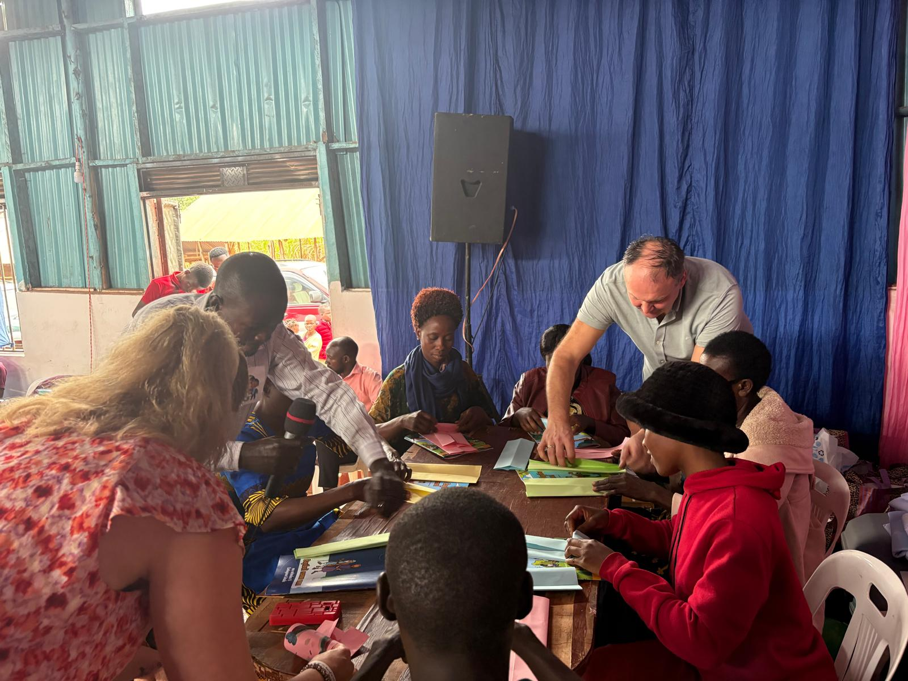

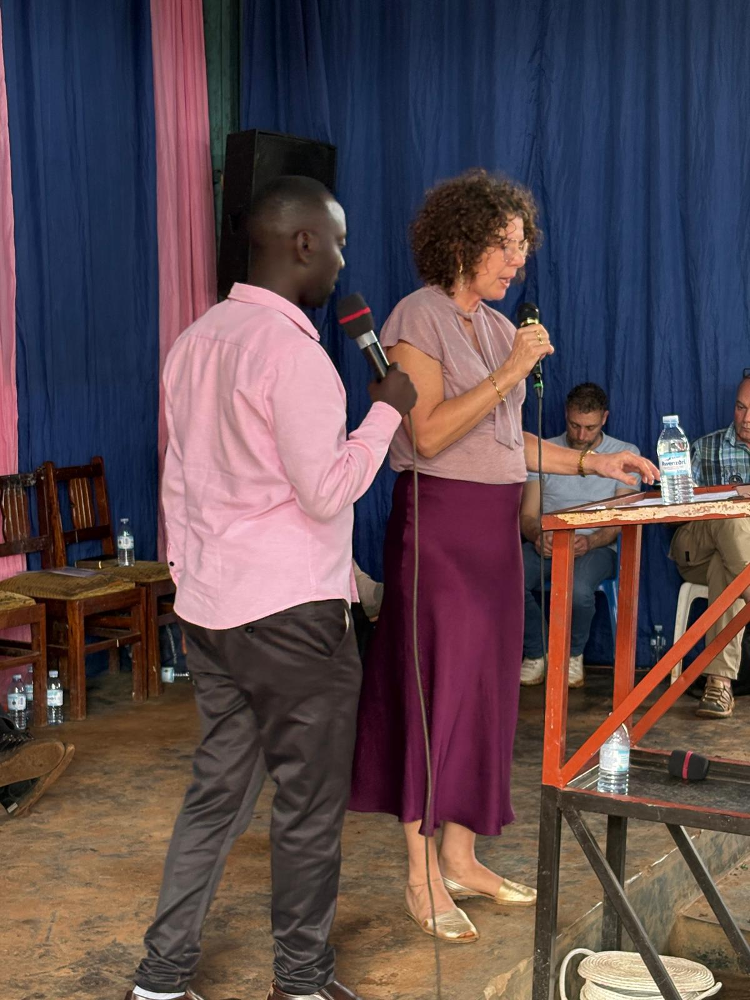

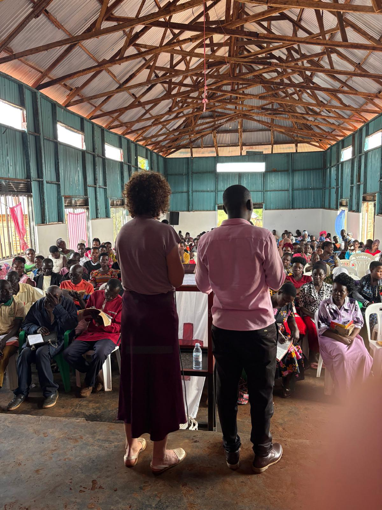

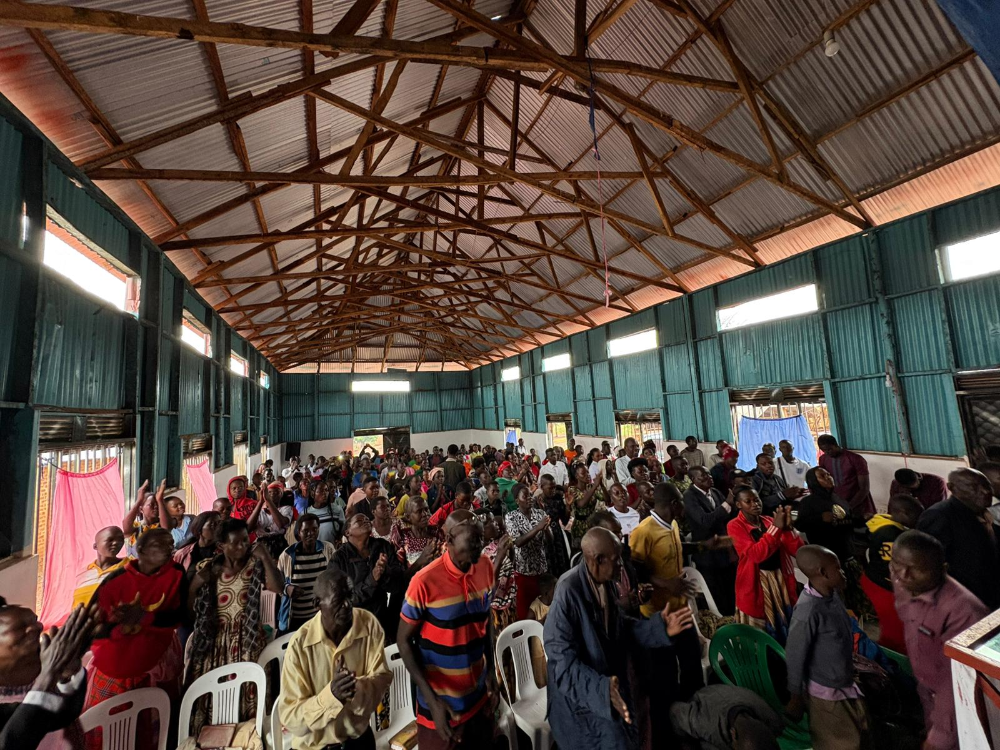

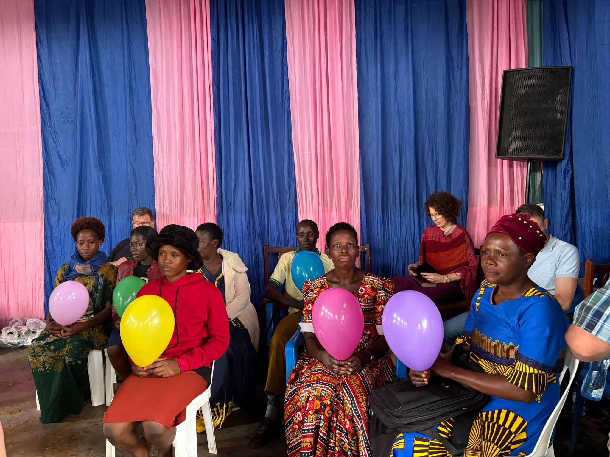

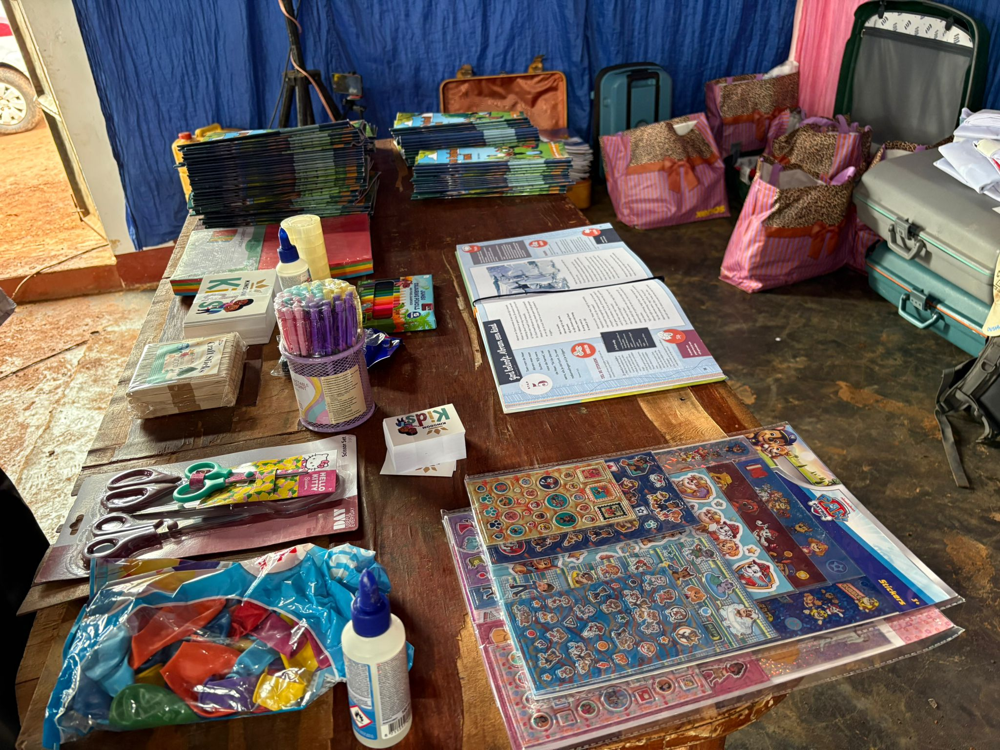

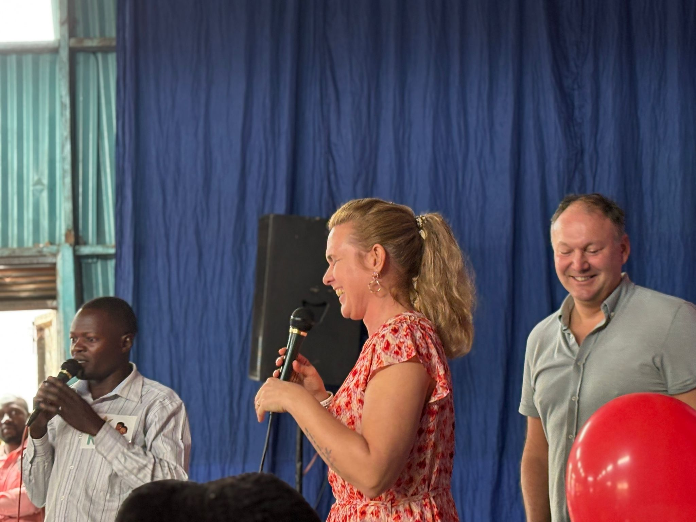

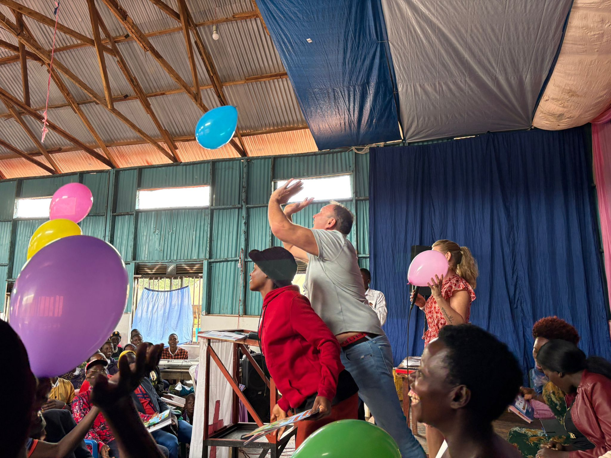

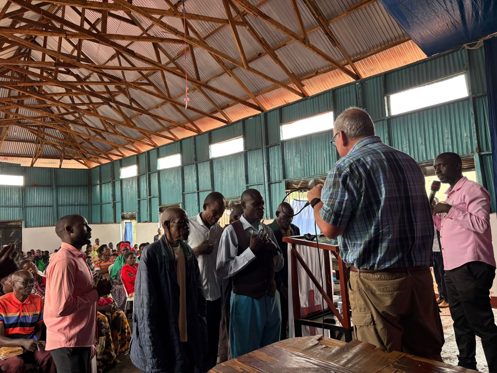

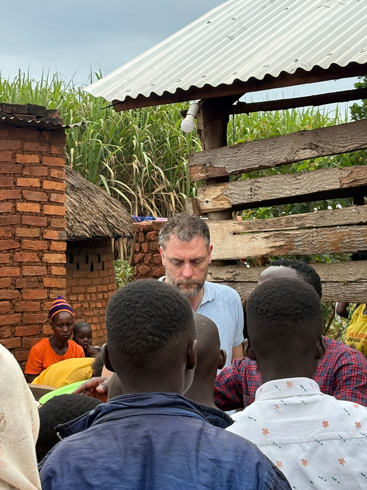

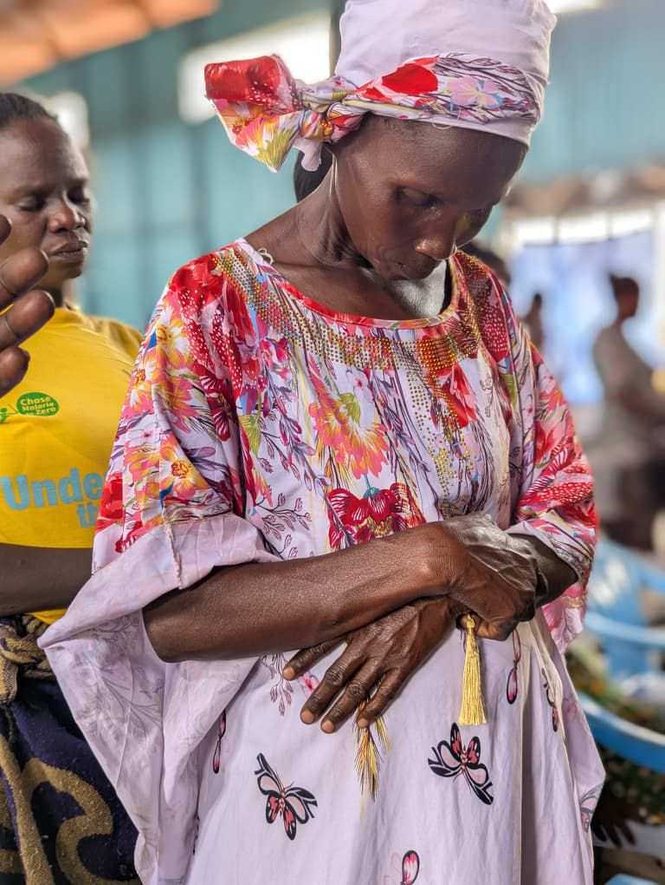

<video controls preload="none" playsinline src="/media/video/WhatsApp-Video-2026-02-07-at-06.29.39.mp4"></video>

<video controls preload="none" playsinline src="/media/video/WhatsApp-Video-2026-02-07-at-06.36.36.mp4"></video>

<video controls preload="none" playsinline src="/media/video/WhatsApp-Video-2026-02-07-at-06.45.51.mp4"></video>
