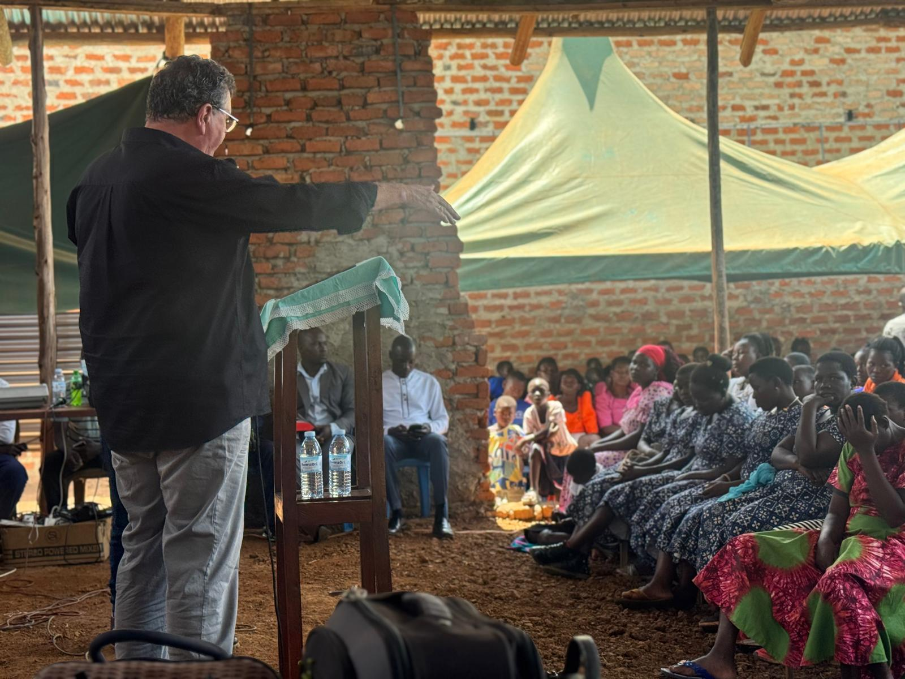
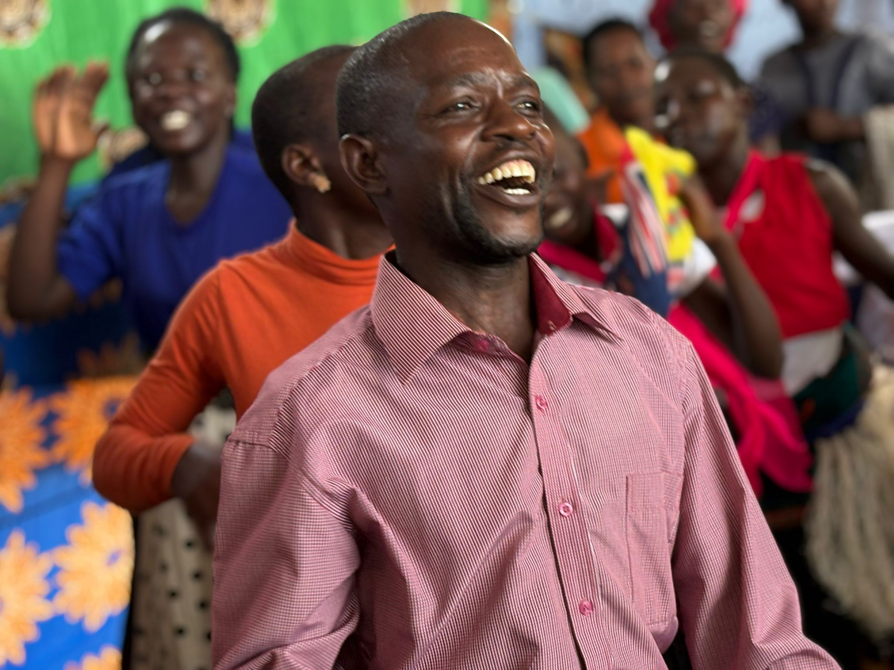
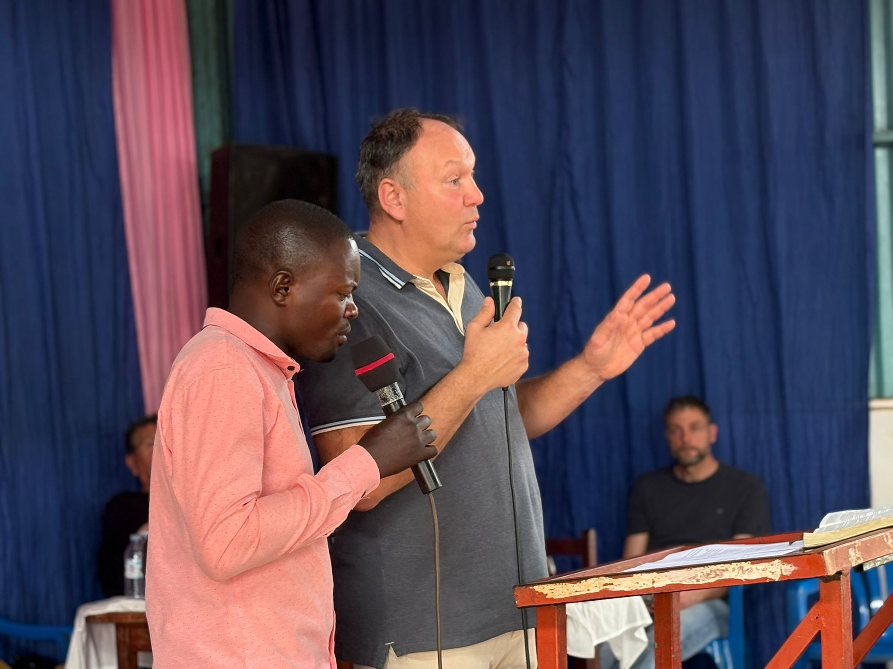
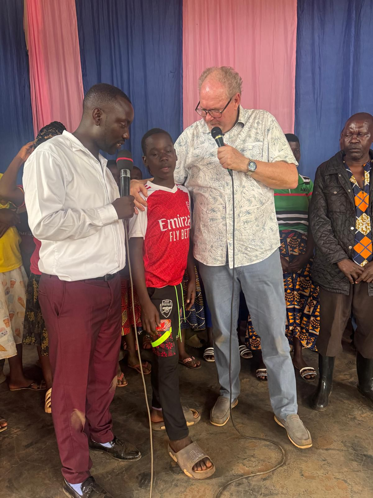
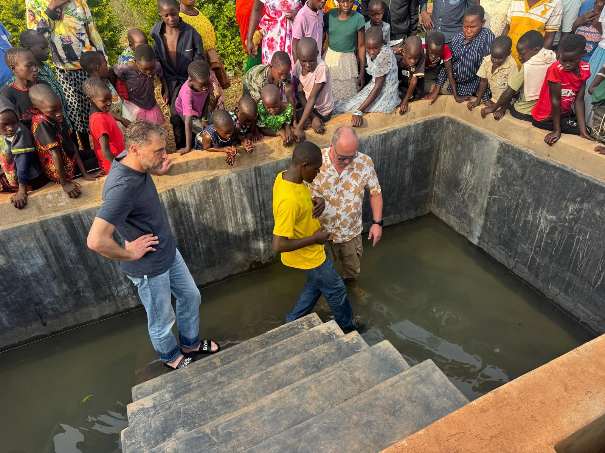
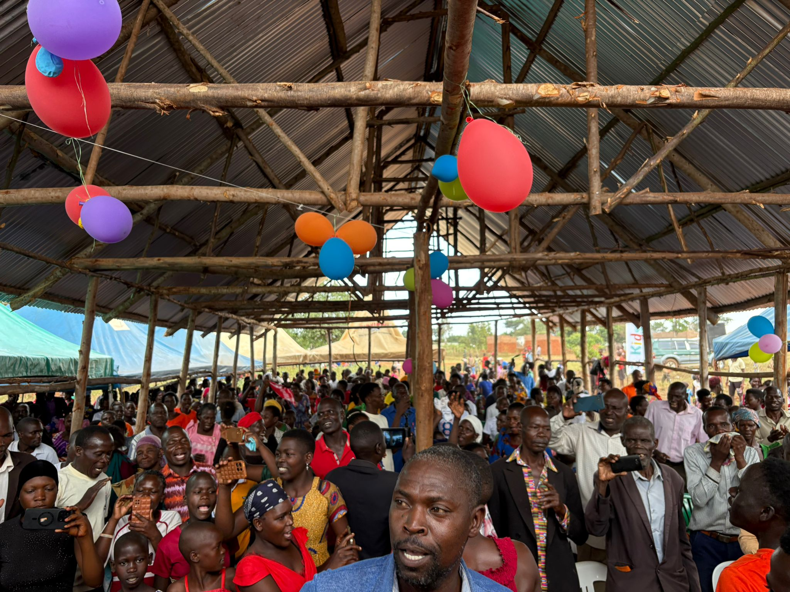
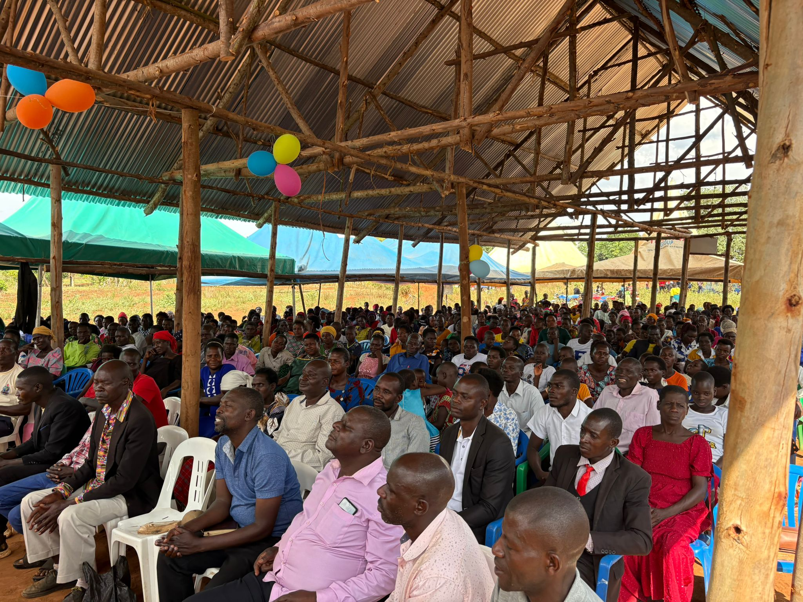

Today was once again an overwhelming and blessed day in which God’s Kingdom visibly broke new ground. The messages were received with open hearts, and we realised once more how powerfully God has destined His church to be a place where He dwells and works in the midst of His children. His love reached out to both the youngest and the oldest.

The day was closed with a festive baptism service. Several guests who had come to watch gave their lives to Jesus, a special moment of grace and new beginnings.

Afterwards we went to two new areas: **Berea**  and **Ephesus** . Both locations were fully set up, and it was the first time for us to serve there. We prayed against the powers of witchcraft, death and destruction, and asked God for protection and breakthroughs.

We have by now returned from two wonderful services in which once again a great deal happened. About **75 people gave their lives to Jesus** , and many miracles took place. We will still receive the testimonies of these, but the gratitude is already great.

We are tired, but deeply grateful for everything God did today. We are going to rest now and prepare for tomorrow’s travel day. Our flight only leaves forty minutes after midnight, so it will be a long day.

Below we share photos and videos that give an impression of this special day.

We bless you with love and God’s nearness.

**The Uganda team**

<video controls preload="metadata" playsinline src="/media/video/WhatsApp-Video-2026-02-08-at-16.27.46.mp4#t=0.1"></video>

<video controls preload="metadata" playsinline src="/media/video/WhatsApp-Video-2026-02-08-at-16.31.43.mp4#t=0.1"></video>

