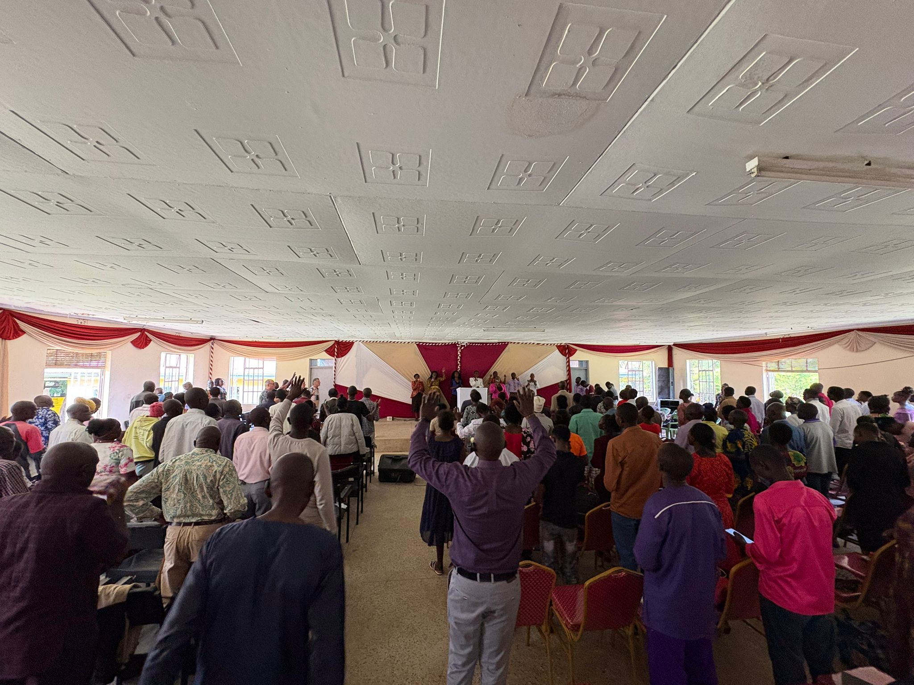
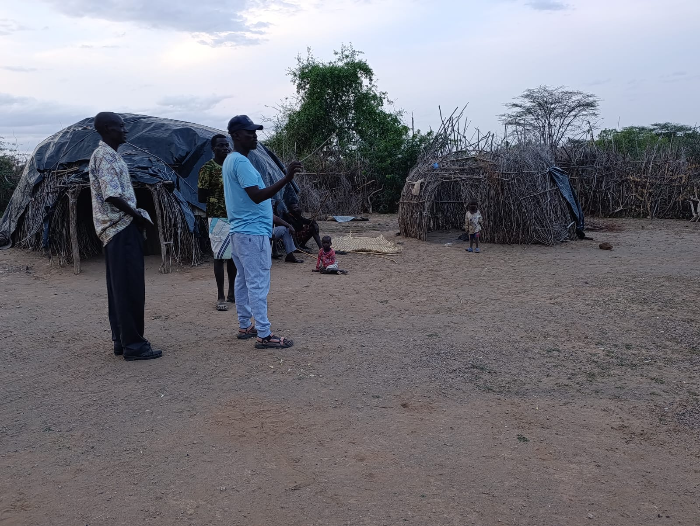

On 26 January a new Bible school starts in the desert area on the border of Kenya and Sudan. More than 50 students are invited for this training, half of whom come from the largest refugee camp in Sudan.

Pastor John — a former student of our Bible school in Webuye — has by now planted six churches in Sudan (Kakuma refugee camp) and twenty-eight churches in the northern border area of Kenya (Turkana Land). With his pioneering heart and our support he is now taking the next step: founding a new training centre for future ministries.

Evangelism in the refugee camp in Sudan

<video controls preload="metadata" playsinline src="/media/video/WhatsApp-Video-2025-11-06-at-19.13.00.mp4#t=0.1"></video>

<video controls preload="metadata" playsinline src="/media/video/WhatsApp-Video-2025-11-06-at-19.15.26.mp4#t=0.1"></video>

