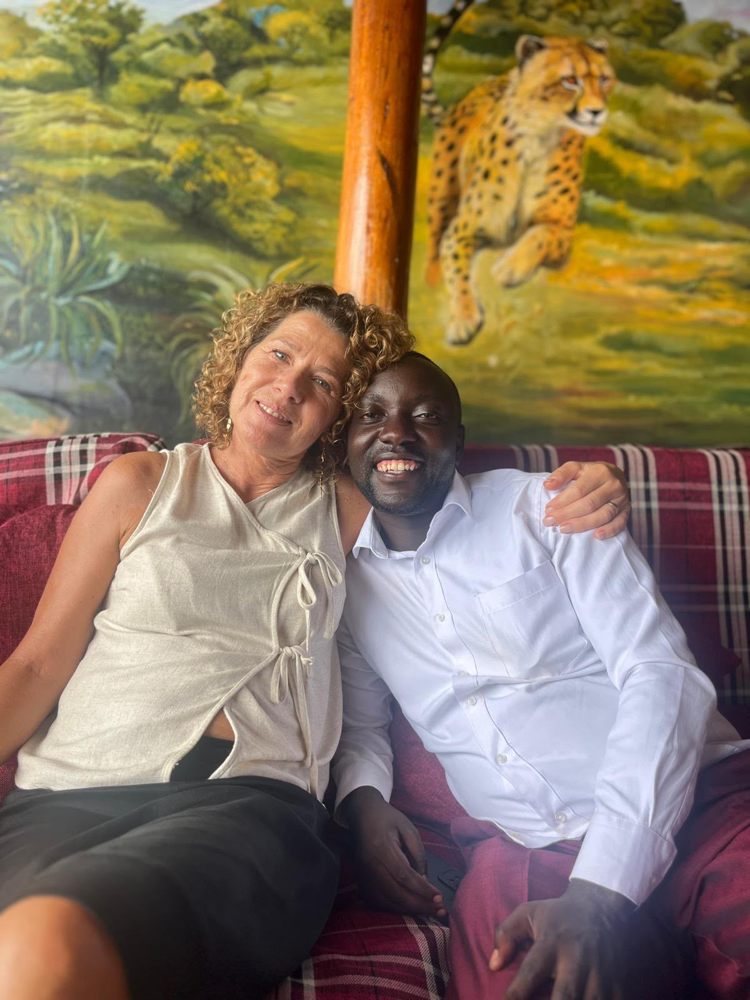
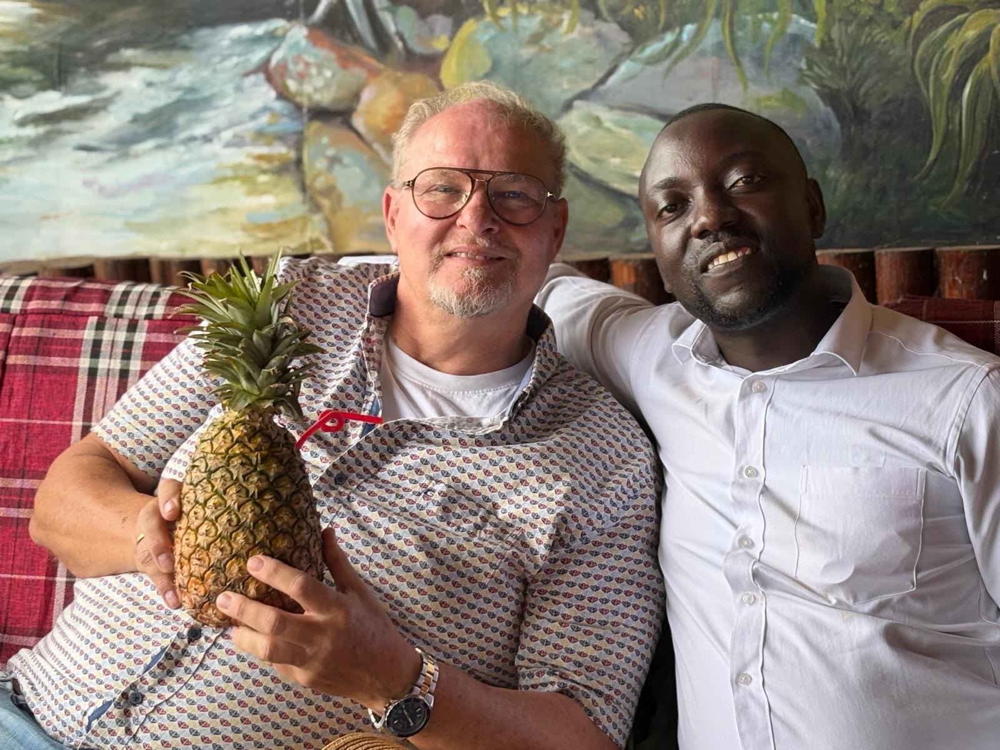
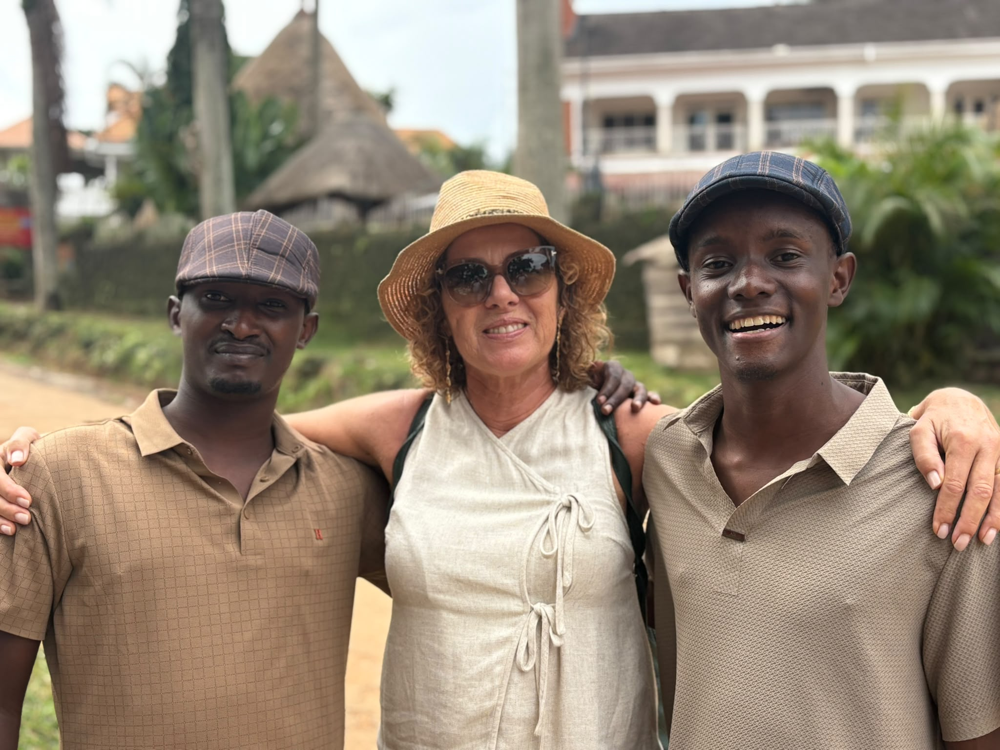
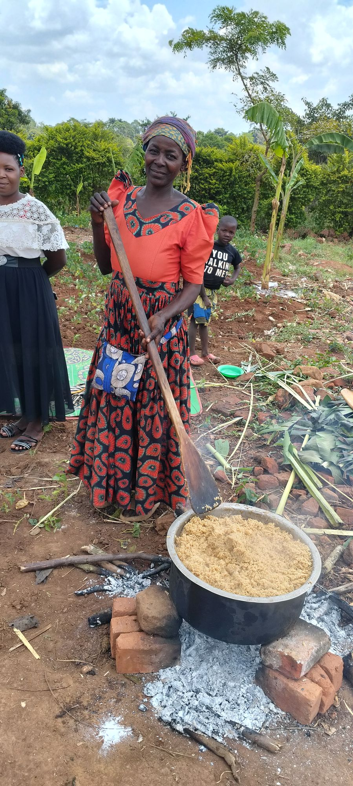
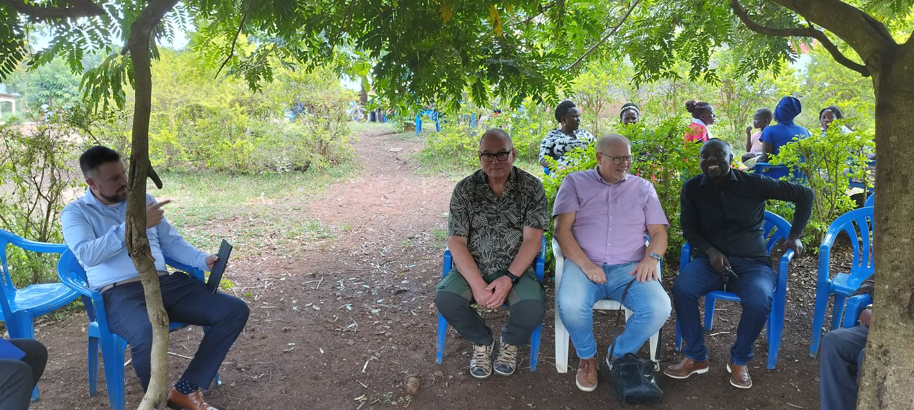
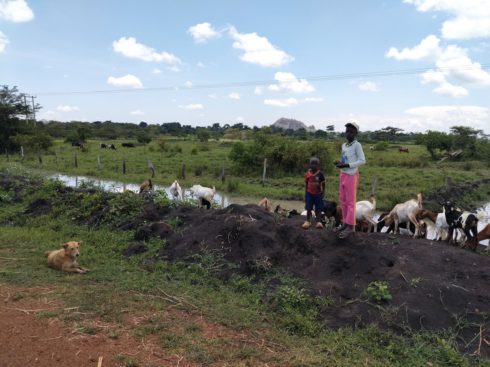
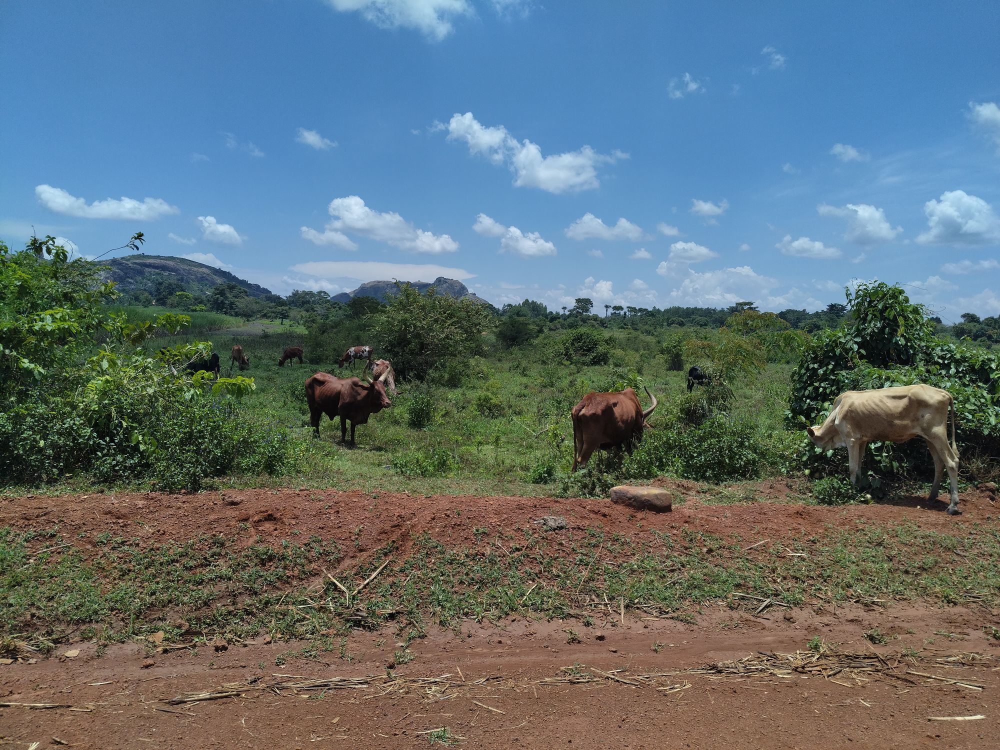
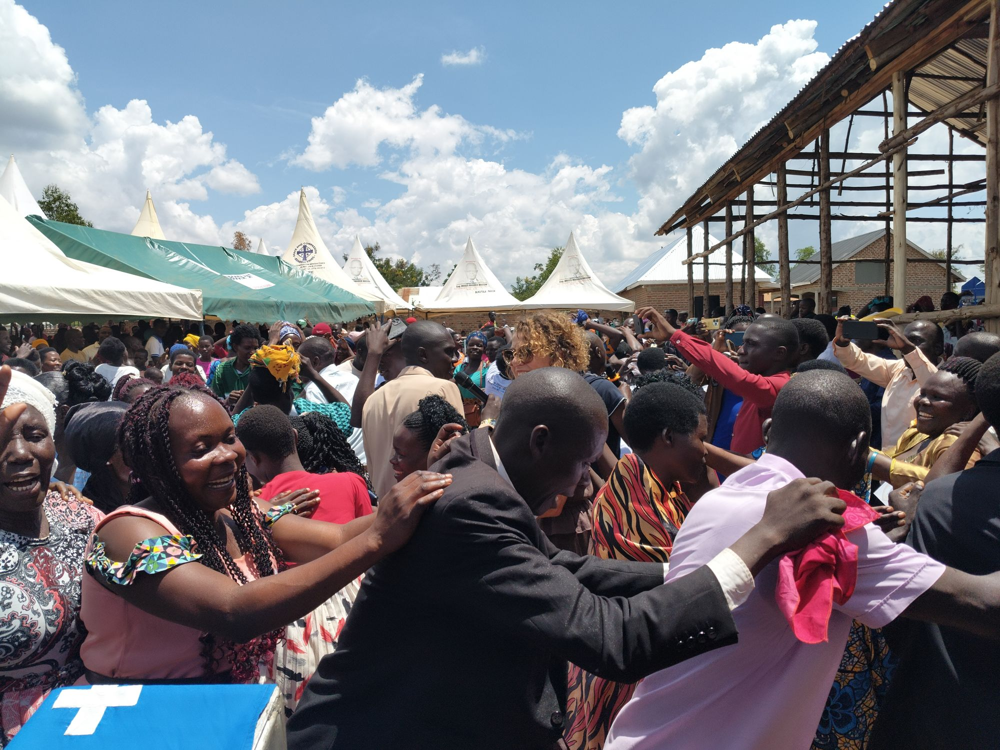

We look back with gratitude on the days of our mission trip to Uganda: days with an open heaven, in which all kinds of things happened. Every service and every seminar was impactful and the notepads were filled.

We saw that teaching is a lifeline that prevents wild growth and mixing of beliefs from taking root. The culture is so different and habits are so deeply rooted in the generations that only the Truth from God’s Word sets free.

Then we travelled to the Philadelphia church, where we held a large mass meeting. We had asked for prayer for a powerful outpouring of God’s Spirit, for converts and many baptisms. The two days that followed were filled with meetings, teaching, equipping and baptising, with a life-changing effect.

Next we travelled to a new cell group. Besides the seven churches there are very many cell groups, which start small and grow to hundreds of believers per cell. Many came to faith; it was a smaller repeat of the Sunday. Unfortunately there was no water available; otherwise we could have baptised many. There is still an enormous logistical challenge here because of the great distances.

Our bodies were pushed to the limit and we are grateful for the strength we received. The photos give a good impression of these days.

Finally we travelled to Entebbe. At 21:00 we flew from Entebbe to Nairobi and at 23:59 from Nairobi to Amsterdam, where we landed on Thursday at 7:45.

We are very grateful for all the visible blessings, and the rest will follow. Thank you for all the prayers.

Warm greetings from all of us
