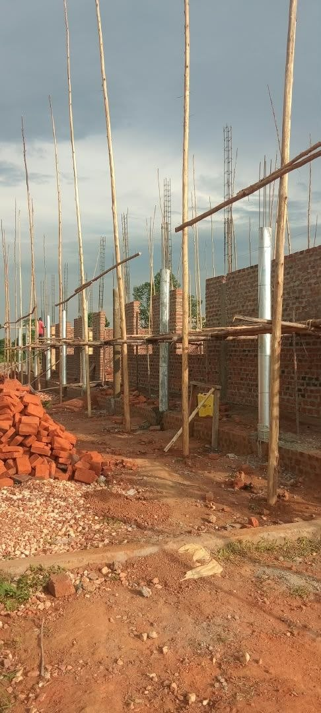
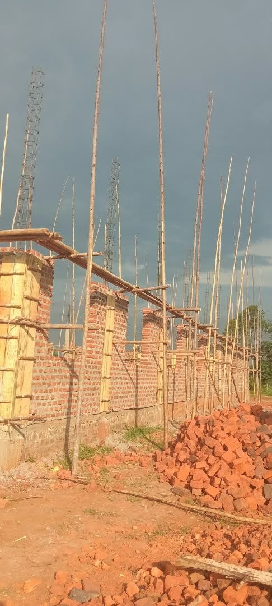
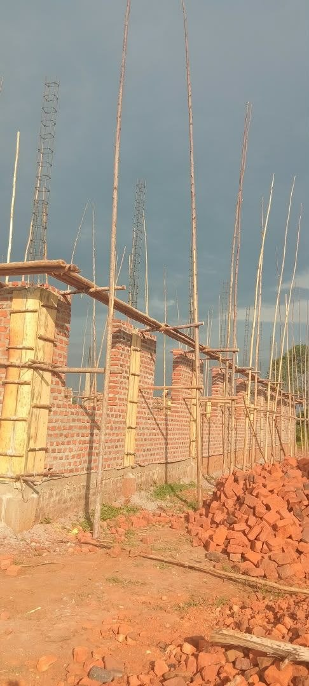
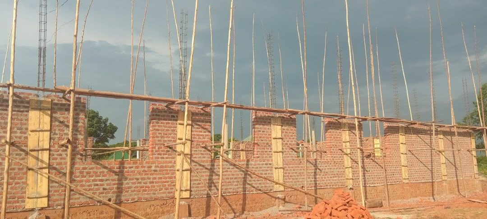

Lieve voorbidders, even een update van het werk in Oeganda na een gesprek met Bonney heden avond.

Na ons bezoek is de outpouring van Gods Geest als een ‘brandende braamstruik’ het gebied doorgegaan (de letterlijke woorden van Bonney).

De getuigenissen stromen door naar compleet nieuwe gebieden waar zelfs andere dialecten worden gesproken, maar Gods Geest openbaart Jezus en Zijn verlossing.

In de zeven gemeenten worden constant (dagelijks) gelovigen gedoopt en het belang hiervan is opgepakt.
Dagelijks blijven mensen tot Jezus komen en keren hun rug toe naar de wereld van afgoderij.

De 70 full time werkers bewegen als een leger samen met de gelovigen uit de zeven gemeenten. Zij gaan overal rond, net als de discipelen, en zien het Koninkrijk baanbreken en halen de zielenoogst binnen.

De bouw van de grote multifunctionele hal van 40 x 15 meter is in volle gang.
Deze plaats (Jeruzalem) wordt het centrum van de revival.
De hal zal worden gebruikt voor de Bijbelscholen om constant nieuwe discipelen en leiders te trainen. Ook voor de samenkomsten op zondag, conferenties en, als we gereed zijn, een educatieplek met een groot scherm, zodat we seminars vanuit Nederland kunnen geven over de meest uiteenlopende thema’s.

Ook kan dan bijvoorbeeld de film van Jezus getoond worden midden in de bush!

Kortom, een geestelijke hotspot waar tienduizenden getraind en toegerust kunnen worden via een Starlink-satellietconnectie.

Blijf bidden en graag ook doneren voor het bouwproject. Elke gift voor de armen is volgens de Schrift een ‘lening aan de Here’.
Hoe bijzonder is dat en wat een voorrecht om te mogen geven.

Er zijn nog twee termijnen van 30.000,- nodig!

U kunt het overmaken op de ANBI-stichting
Bread for the hungry ministries
NL11RABO 0317 2284 63

Ontvang onze warme zegengroet,
Bert en Nancy

<video controls preload="metadata" playsinline src="/media/video/issue-10-video-1.mp4#t=0.1"></video>

<video controls preload="metadata" playsinline src="/media/video/issue-10-video-2.mp4#t=0.1"></video>

