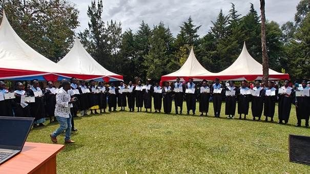

Op donderdag 12 november hebben ruim 40 full time Bijbelschool studenten op onze Bijbelschool in Webuye - Kenia hun fel begeerde diploma gehaald. Omdat wij zelf eind november naar Noord Kenia gaan om de Bijbelschool die daar in januari is gestart, heeft broeder Dick Pieterman ons vertegenwoordigd in Webuye.

De impact van deze Bijbelschool is enorm en heeft inmiddels in haar 16 jarig bestaan meer dan 100 gemeenten voortgebracht.

Bijgaand de toespraak tot de studenten van David Waluku, de directeur van de Bijbelschool:

Prijs de Heer!

Ik sta vandaag voor u niet alleen als uw directeur, maar ook als oprichter samen met pastor Bert de Haan en ps. Dick Pieterman, die deze school in een visioen zagen voordat ze een gebouw had, voordat ze leerlingen had, voordat ze iets had - alleen een belofte van God.
Toen we de Bijbelschool begonnen, hadden we geen geld. We hadden alleen geloof. Vandaag kijk ik naar jullie in jullie gewaden en zeg ik: God is trouw!

Aan onze sponsors: Jullie zijn de pijlers. Jullie gaven jullie geld, jullie trouwste gebeden. Jullie geloofden in een visioen dat jullie nog niet konden zien.
Hebreeën 6:10 zegt: ’God is niet onrechtvaardig; hij zal uw werk niet vergeten.’ God zal u niet vergeten. Namens de Bijbelschool zeg ik – ‘Asante sana’. Mogen uw schuren nooit opdrogen.

Aan ons leiderschapsteam en onze leraren: Jullie droegen deze visie met ons mee. Als ik moe was, baden jullie. Als leerlingen zwak waren, versterkte jullie hen.
Zoals John Maxwell zei: ’Een leider is iemand die de weg kent, de weg gaat en de weg wijst.’ Jullie hebben de weg gewezen.
Je hebt niet alleen de Bijbel onderwezen, je leefde de Bijbel vóór deze studenten.

Aan onze afgestudeerden - mijn ‘kinderen’: Jullie zijn mijn eerste vruchten. Jullie zijn de reden dat de Bijbelschool is opgericht.
We hebben deze school niet gebouwd voor competitie. We hebben haar gebouwd op eenheid en vertrouwen. Prediker 4:12 ’Een koord van drie draden wordt niet snel gebroken.’ Sponsors, leraren en leerlingen - wij werden één koord, en daarom staan we hier vandaag.
Zoals het Afrikaanse spreekwoord zegt: ‘Als je snel wilt gaan, ga dan alleen. Als je ver wilt gaan, ga dan samen.’ Wij kozen ervoor om samen te gaan, en we zijn ver gekomen.

Hoe nu verder?

Afstuderen is geen afscheid. Het is een uitzending.
2 Timoteüs 2:2 zegt: ‘En wat u mij hebt horen zeggen... vertrouw dat toe aan betrouwbare mensen die ook gekwalificeerd zijn om anderen te onderwijzen.’ Ik vertrouw het evangelie nu aan jullie toe.
Ga! Ga kerken planten. Ga en preek met liefde. Ga en dien met nederigheid.
Zoals Nelson Mandela zei: ‘Het lijkt altijd onmogelijk totdat het gedaan is.’ Wij hebben het mogen doen. En jullie zullen grotere dingen doen.
Jeremia 29:11 ‘Want Ik weet welke gedachten Ik over u koester, luidt het woord des Heren, gedachten van vrede en niet van onheil, om u een hoopvolle toekomst te geven’

De Bijbelschool zal doorgaan. We zullen meer studenten trainen. We zullen meer discipelen uitzenden. Omdat de oogst nog steeds groot is.

Ik zegen je vandaag. Ga met succes. Ga in kracht. Ga in de naam van Jezus.

Ik ben trots op jullie
God zegene de Bijbelschool!

